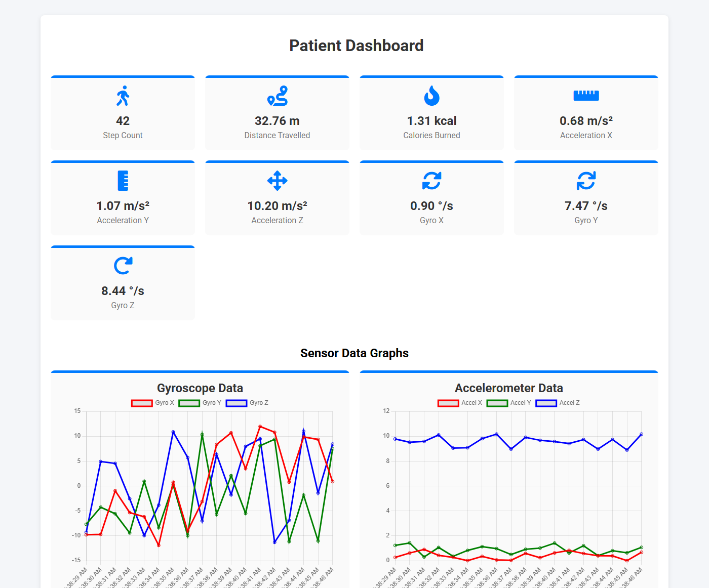
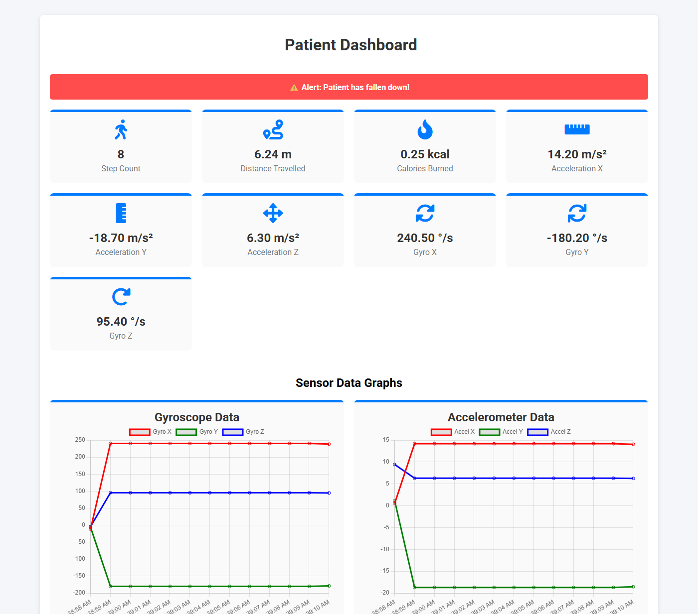
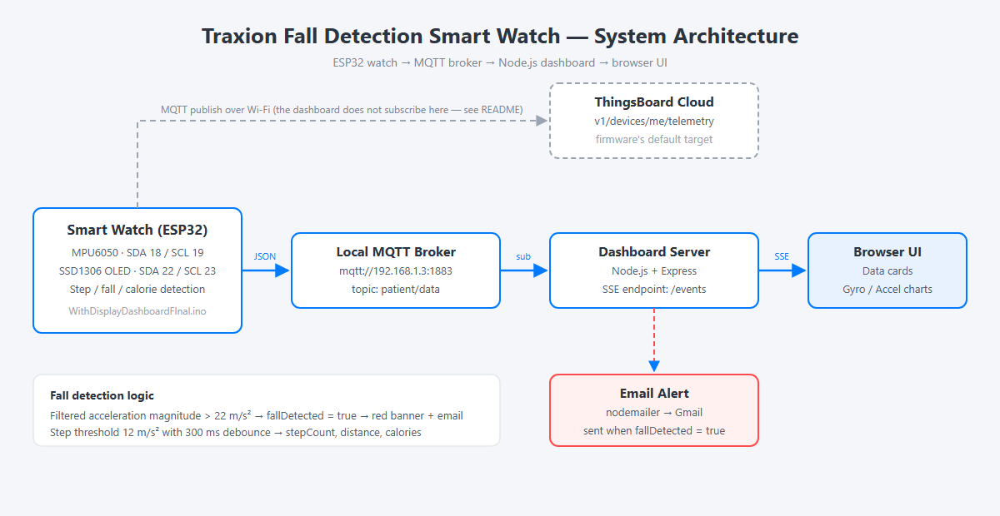

# Traxion — Fall Detection Smart Watch

A wearable fall-detection and activity tracker built on an ESP32, with a live web
dashboard for a caretaker.

The watch reads an MPU6050 accelerometer/gyroscope, detects falls and steps, shows
the step count on a small OLED, and publishes telemetry over MQTT. A Node.js
dashboard subscribes to that telemetry and shows it in real time (step count,
distance, calories, raw accel/gyro values, live charts) and raises a red alert —
plus an email — when a fall is detected.



| Fall alert | System architecture |
|---|---|
|  |  |

---

## Contents

- [Repository layout](#repository-layout)
- [Features](#features)
- [Hardware](#hardware)
- [Firmware](#firmware)
- [Dashboard](#dashboard)
- [MQTT broker](#mqtt-broker)
- [Data format](#data-format)
- [Testing without the watch](#testing-without-the-watch)
- [Troubleshooting](#troubleshooting)
- [Security notes](#security-notes)

---

## Repository layout

```
Traxion fall detection smart watch/
├── WithDisplayDashboardFInal.ino     ESP32 firmware (Arduino sketch)
├── secrets.example.h                 Credentials template (copy to secrets.h)
├── dashboard/
│   ├── server.js                     Express + MQTT + SSE + email alert
│   ├── package.json
│   ├── .env.example                  Config reference
│   ├── public/
│   │   └── index.html                Dashboard UI (cards + Chart.js graphs)
│   └── tools/
│       ├── broker.js                 Local MQTT broker for offline testing
│       ├── mock-publisher.js         Fake telemetry (no hardware needed)
│       └── screenshot.js             Captures dashboard screenshots
└── docs/screenshots/                 README images
```

## Features

- **Fall detection** — filtered acceleration magnitude above `22 m/s²` sets `fallDetected`.
- **Step counting** — `12 m/s²` threshold with a `300 ms` debounce.
- **Distance & calories** — step length `0.78` m, weight `70` kg, `0.57` kcal/km/kg.
- **OLED display** — live step count on a 128×64 SSD1306.
- **Live dashboard** — cards + gyroscope and accelerometer line charts over SSE.
- **Fall alert** — red banner in the browser and an email to the caretaker.

## Hardware

| Component | Purpose | ESP32 pins |
|---|---|---|
| ESP32 dev board | Main controller, Wi-Fi + MQTT | — |
| MPU6050 | Accelerometer + gyroscope | SDA `18`, SCL `19` |
| SSD1306 OLED 128×64 | Step counter display | SDA `22`, SCL `23`, address `0x3C` |

The two I²C buses are separate (`Wire` for the MPU6050, `TwoWire(1)` for the OLED),
so they can run at different speeds.

## Firmware

Open `WithDisplayDashboardFInal.ino` in the Arduino IDE and install these libraries
via **Tools → Manage Libraries**:

| Library | Author |
|---|---|
| `Adafruit MPU6050` | Adafruit |
| `Adafruit Unified Sensor` | Adafruit |
| `Adafruit GFX Library` | Adafruit |
| `Adafruit SSD1306` | Adafruit |
| `ArduinoJson` | Benoit Blanchon |
| `PubSubClient` | Nick O'Leary |

Select **ESP32 Dev Module**, then create your credentials file (it is git-ignored):

```powershell
Copy-Item secrets.example.h secrets.h
```

Edit `secrets.h` and fill in your Wi-Fi name/password and ThingsBoard token:

```cpp
#define WIFI_SSID "your-wifi-name"
#define WIFI_PASSWORD "your-wifi-password"
#define TB_TOKEN "your-thingsboard-access-token"
#define TB_DEVICE_ID "your-thingsboard-device-id"
```

The sketch reads them with `#include "secrets.h"`, so no credentials are stored in
the code itself. `secrets.h` must sit next to `WithDisplayDashboardFInal.ino`.

> ⚠️ **Important:** the firmware publishes to **ThingsBoard Cloud**
> (`v1/devices/me/telemetry`), while the dashboard subscribes to a **local** broker
> on the topic `patient/data`. They are two different destinations, so the dashboard
> will not receive data until you bridge them — see
> [MQTT broker](#mqtt-broker).

## Dashboard

Requires **Node.js 18 or newer**.

```powershell
cd dashboard
npm install
npm start
```

Open <http://localhost:3000>.

### Configuration

Copy `dashboard/.env.example` to `dashboard/.env` and adjust the values, or set them
as environment variables. `.env` is git-ignored.

| Variable | Default | Meaning |
|---|---|---|
| `MQTT_BROKER_URL` | `mqtt://192.168.1.3` | Broker the dashboard subscribes to |
| `MQTT_TOPIC` | `patient/data` | Telemetry topic |
| `PORT` | `3000` | HTTP port |
| `EMAIL_USER` | *(not set)* | Gmail account used to send alerts — alerts stay disabled until all three email values are set |
| `EMAIL_PASS` | *(not set)* | Gmail **App Password** |
| `ALERT_TO` | *(not set)* | Caretaker email address |

### npm scripts

| Command | What it does |
|---|---|
| `npm start` | Runs the dashboard server |
| `npm run dev` | Same, with auto-restart on file changes |
| `npm run broker` | Starts a local MQTT broker on `127.0.0.1:1883` (dev only) |
| `npm run mock` | Publishes fake walking telemetry |
| `npm run mock:fall` | Publishes telemetry that turns into a fall alert |
| `node tools/screenshot.js` | Saves `docs/screenshots/01-dashboard.png` |

## MQTT broker

The dashboard expects a broker at **`192.168.1.3:1883`** with the topic
`patient/data`. Change `MQTT_BROKER_URL` if your broker runs elsewhere.

### Option A — Mosquitto on the same network

On the machine with IP `192.168.1.3`, create a minimal config:

```conf
listener 1883 0.0.0.0
allow_anonymous true
```

Start it:

```powershell
mosquitto -c mosquitto.conf -v
```

> `allow_anonymous true` is fine for a lab/demo. Use authentication if the broker is
> reachable from outside your home network.

### Option B — local broker for development

If you only want to try the dashboard on one machine:

```powershell
cd dashboard
npm run broker                                   # terminal 1 -> mqtt://127.0.0.1:1883
$env:MQTT_BROKER_URL = "mqtt://127.0.0.1:1883"
npm start                                        # terminal 2
npm run mock                                     # terminal 3
```

### Getting the real watch data into the dashboard

The sketch sends telemetry to ThingsBoard, so pick one of these:

1. **Point the firmware at your broker (simplest).** In the sketch, change
   `mqtt_server` to the broker IP, use no token (or your broker's credentials) and
   publish to `patient/data`. Then the dashboard works as-is.
2. **Bridge ThingsBoard → broker.** Add an MQTT output node in a ThingsBoard rule
   chain (or poll the REST API) that republishes the device telemetry to
   `patient/data` on `192.168.1.3`.

## Data format

Every message on `patient/data` is a JSON object:

```json
{
  "stepCount": 42,
  "distance": 32.76,
  "caloriesBurned": 1.307,
  "fallDetected": false,
  "accelX": 0.003,
  "accelY": 0.632,
  "accelZ": 8.894,
  "gyroX": 9.366,
  "gyroY": -11.014,
  "gyroZ": -1.382
}
```

| Field | Unit |
|---|---|
| `stepCount` | steps |
| `distance` | metres |
| `caloriesBurned` | kcal |
| `fallDetected` | boolean |
| `accelX/Y/Z` | m/s² |
| `gyroX/Y/Z` | °/s |

`fallDetected: true` shows the red banner and sends one email per message.

## Testing without the watch

With the broker running (see Option B):

```powershell
npm run mock        # normal walking data
npm run mock:fall   # after a few readings the fall alert triggers
```

Both scripts accept `MQTT_BROKER_URL` / `MQTT_TOPIC` overrides, so you can also
publish straight to the real broker.

## Troubleshooting

| Symptom | Cause / fix |
|---|---|
| Dashboard shows `0` everywhere | No data on the topic. Check `MQTT_BROKER_URL`, that the broker is running, and that the firmware/bridge publishes to `patient/data`. |
| `MQTT error (...) ECONNREFUSED` in the console | The broker is not reachable on that IP/port. Start it, or fix the URL. The server keeps retrying every 5 s. |
| Page loads but icons are missing | The Font Awesome stylesheet is blocked — the `integrity` hash in `public/index.html` must match the CDN file. |
| Charts stay empty but cards update | Chart.js failed to load from the CDN; check the browser console / internet access. |
| `Email error: Invalid login` | Gmail rejected the password. Use a 16-character **App Password** (Google Account → Security → 2-Step Verification → App passwords). |
| `Email alerts are disabled` in the console | `EMAIL_USER`, `EMAIL_PASS` and `ALERT_TO` are not all set. Add them to `dashboard/.env`. |
| `SSD1306 allocation failed` on the watch | OLED not found at `0x3C`. Check wiring and that the display runs on `Wire1` (`SDA 22`, `SCL 23`). |
| `Failed to find MPU6050 chip` | Check `SDA 18` / `SCL 19`, power, and pull-ups. |

## Security notes

Credentials are **not** stored in the code anymore:

- The firmware reads Wi-Fi and ThingsBoard values from `secrets.h` (git-ignored).
- The dashboard reads email settings from `dashboard/.env` (git-ignored).

```powershell
Copy-Item secrets.example.h secrets.h
Copy-Item dashboard/.env.example dashboard/.env
```

### Rotate the old credentials

Earlier commits still contain the development Wi-Fi password, Gmail password and
ThingsBoard token. If the repository is public, treat those values as leaked and
rotate them:

1. **Gmail** — Google Account → Security → 2-Step Verification → App passwords →
   delete the old app password → create a new one → put it in `dashboard/.env`.
2. **Wi-Fi** — change the router password, then update `secrets.h`.
3. **ThingsBoard** — open the device → *Manage credentials* → regenerate the access
   token → update `secrets.h`.

Rewriting the git history with `git filter-repo` is optional; rotating the values is
what actually makes the leaked ones useless.

Finally, do not expose the dashboard or the broker to the public internet without
authentication.

## Screenshots

Regenerate the dashboard images (server + mock publisher running):

```powershell
cd dashboard
node tools/screenshot.js
node tools/screenshot.js --out ../docs/screenshots/02-fall-alert.png
```

`docs/screenshots/03-architecture.svg` is the source of the architecture diagram;
open it in a browser to export a new PNG.
